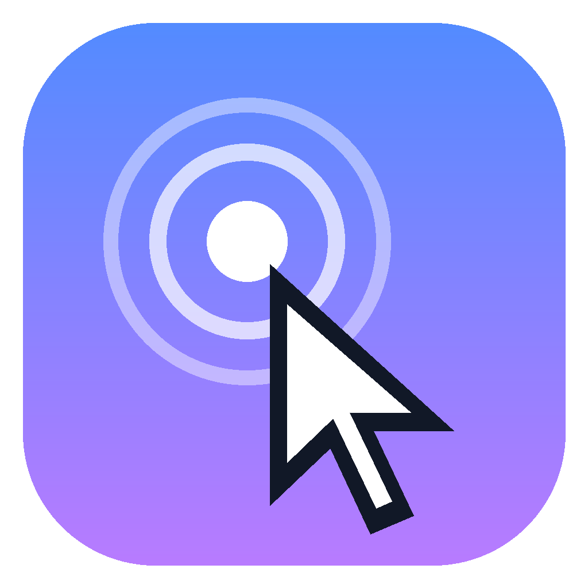
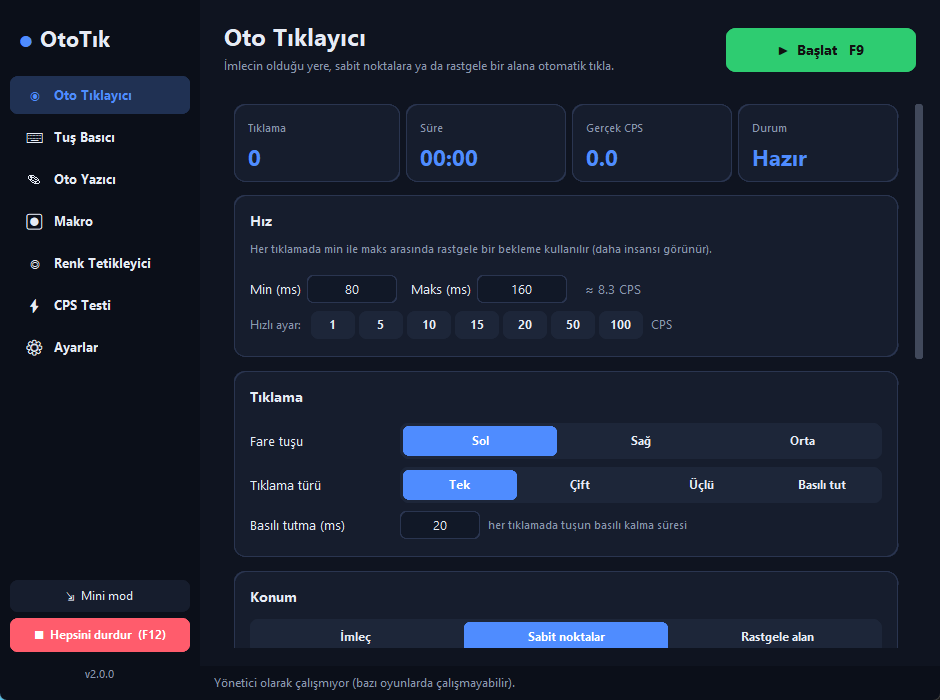
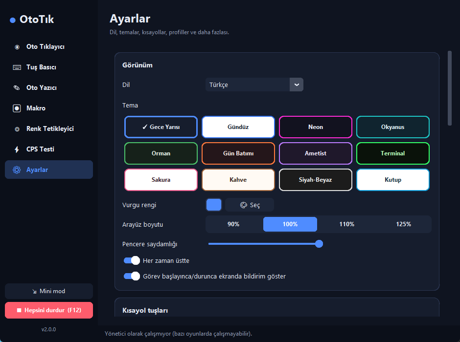
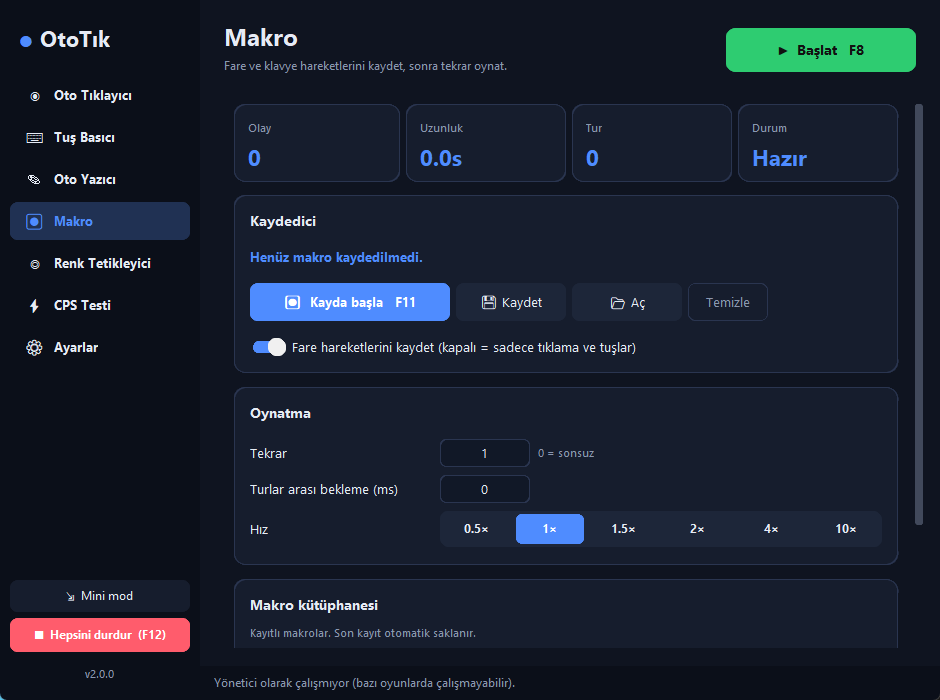
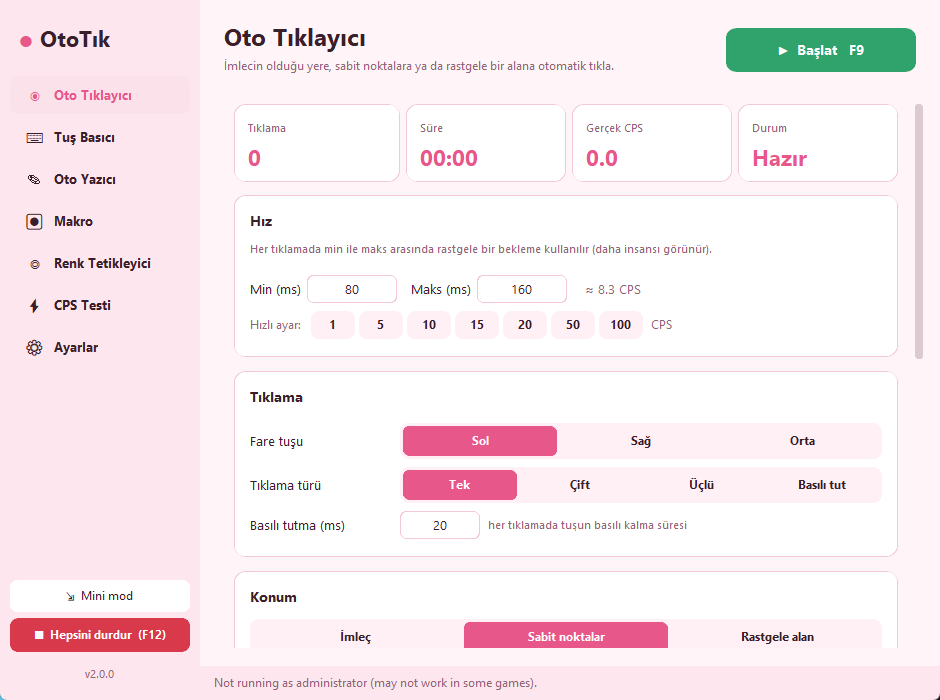
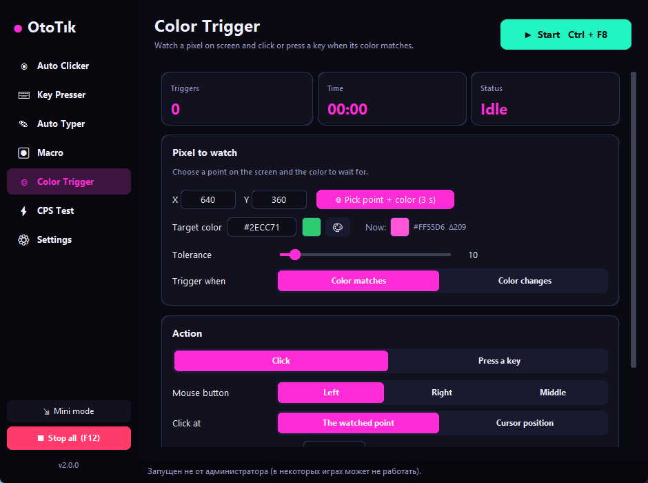
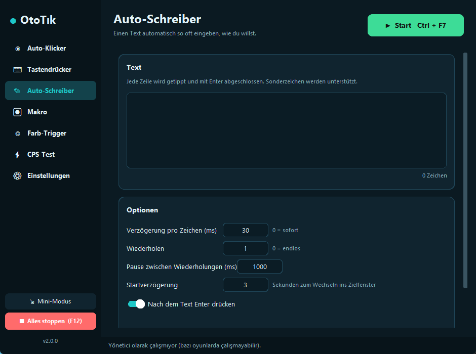
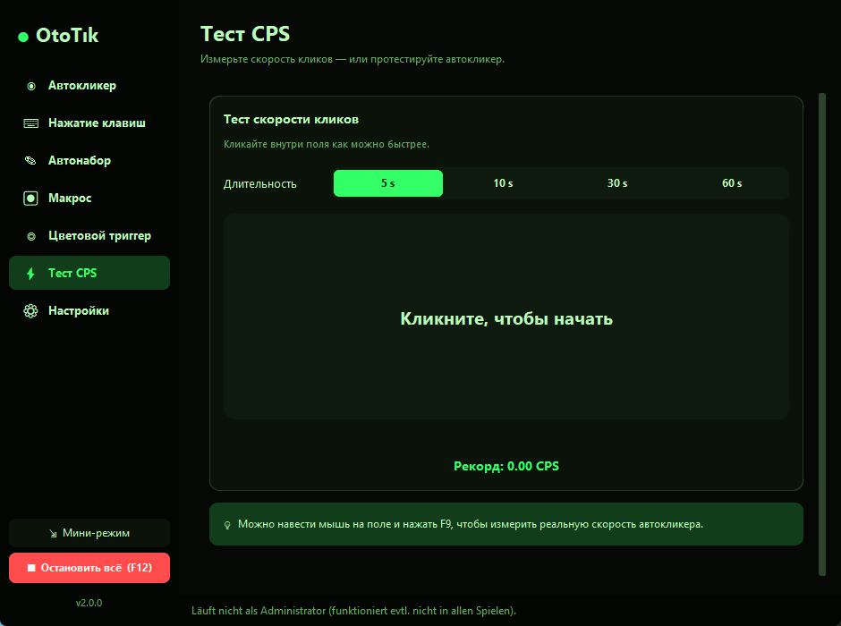
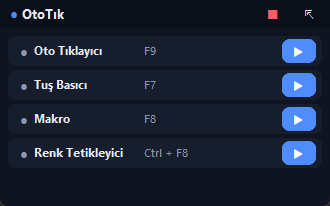

<div align="center">



# OtoTık

**Oto tıklayıcı, tuş basıcı, oto yazıcı, makro kaydedici ve renk tetikleyici — tek uygulamada.**

7 dil · 12 tema · özelleştirilebilir kısayollar · profiller · mini mod

[**⬇ OtoTik.exe'yi indir**](../../releases/latest) · [English](#english)



</div>

---

## ✨ Özellikler

| Modül | Ne yapar? |
|---|---|
| 🖱 **Oto Tıklayıcı** | Sol / sağ / orta tuş; tek, çift, üçlü tıklama veya **basılı tutma**. İmlecin olduğu yere, **sınırsız sayıda sabit noktaya sırayla** ya da iki köşe arasındaki **rastgele bir alana** tıklar. Min–maks aralıkla insansı rastgele hız, hızlı CPS ayarları (1–100), jitter (piksel sapması), tıkladıktan sonra imleci geri getirme. |
| ⌨ **Tuş Basıcı** | Bir tuşa ya da kombinasyona (`space`, `e`, `ctrl+c`, `shift+f`…) belirli aralıkla tekrar tekrar basar. Tuşu algılama butonu, basılı tutma süresi, basış limiti. |
| ✎ **Oto Yazıcı** | Bir metni (çok satırlı, Türkçe karakterler dahil) istediğin kadar tekrar yazdırır; karakter başı gecikme, tekrarlar arası bekleme, sonda Enter. |
| ⏺ **Makro** | Fare + klavye hareketlerini kaydet, 0.5×–10× hızda, istediğin kadar (veya sonsuz) oynat. Makroları dosyaya kaydet/yükle, makro kütüphanesi, son kayıt otomatik saklanır. Kısayol tuşları kayda **girmez**. |
| ◎ **Renk Tetikleyici** | Ekrandaki bir pikseli izler; renk **eşleşince** veya **değişince** tıklar ya da tuşa basar. Canlı renk önizleme, tolerans, bekleme süresi, tek seferlik mod. |
| ⚡ **CPS Testi** | 5/10/30/60 sn tıklama hızı testi ve rekor. Oto tıklayıcının gerçek hızını ölçmek için de kullanılabilir. |

**Ayrıca:**

- 🌍 **7 dil:** Türkçe, English, Deutsch, Español, Français, Português, Русский (ilk açılışta sistem dili otomatik seçilir)
- 🎨 **12 tema:** Gece Yarısı, Gündüz, Neon, Okyanus, Orman, Gün Batımı, Ametist, Terminal, Sakura, Kahve, Siyah-Beyaz, Kutup + **özel vurgu rengi**
- ⌨ **Tüm kısayollar değiştirilebilir** — tuş kombinasyonları (`ctrl+f8`) ve **farenin yan tuşları** (Mouse 4/5) desteklenir
- ⏯ **Basılı tuttukça çalış** modu (kısayolu bıraktığında durur)
- ⏰ **Zamanlayıcı:** belirli bir saatte (SS:DD) otomatik başlat; tıklama/süre limiti, başlatma gecikmesi
- 👤 **Profiller:** her oyun için ayrı ayar kaydet, tek tıkla geç; ayarları dışa/içe aktar
- 🪟 **Mini mod:** her zaman üstte duran küçük kontrol paneli
- 🔔 **Ekran bildirimi (OSD):** pencere gizliyken bile başladı/durdu bilgisi
- 🛑 **Acil durdurma:** `F12` ya da fareyi ekranın **sol üst köşesine** götür
- 🙈 **Gizle tuşu** (`F10`), pencere saydamlığı, arayüz boyutu (90–125%)
- 📊 **İstatistikler:** toplam tıklama, tuş, çalışma süresi, en iyi CPS
- 🛡 **Yönetici olarak yeniden başlat** butonu (yönetici modda çalışan oyunlar için)
- 💾 Ayarlar otomatik kaydedilir (Kaydet butonuna basmaya gerek yok)

## 📸 Ekran görüntüleri

| Temalar & ayarlar | Makro |
|---|---|
|  |  |
| **Sakura teması** | **Neon teması · English** |
|  |  |
| **Okyanus · Deutsch** | **Terminal · Русский** |
|  |  |

<p align="center"><b>Mini mod</b><br></p>

## 🚀 Kurulum

### Seçenek 1 — Hazır EXE (önerilen)
[Releases](../../releases/latest) sayfasından **`OtoTik.exe`**'yi indir ve çalıştır. Kurulum gerekmez.

> Windows SmartScreen "tanınmayan uygulama" uyarısı verebilir: **Ek bilgi → Yine de çalıştır**. Bazı antivirüsler, klavye/fare kontrol eden her programı (oto tıklayıcılar dahil) yanlış pozitif olarak işaretleyebilir; kaynak kodun tamamı bu depodadır, istersen kendin derleyebilirsin.

### Seçenek 2 — Kaynaktan çalıştır
```bash
git clone https://github.com/furkibayashi/OtoTik.git
cd OtoTik
pip install -r requirements.txt
python -m ototik
```
(veya `OtoTik.pyw` dosyasına çift tıkla)

### Kendin EXE derle
```bash
build.bat
```
Çıktı: `dist\OtoTik.exe`

## ⌨ Varsayılan kısayollar

| Tuş | Eylem |
|---|---|
| `F8` | Oto tıklayıcı başlat / durdur |
| `F7` | Tuş basıcı başlat / durdur |
| `Ctrl + F7` | Oto yazıcı başlat / durdur |
| `F11` | Makro kaydı başlat / durdur |
| `F9` | Makroyu oynat / durdur |
| `Ctrl + F8` | Renk tetikleyici başlat / durdur |
| `F6` | İmlecin olduğu yeri tıklama noktası olarak ekle |
| `F12` | **Her şeyi durdur** |
| `F10` | Pencereyi gizle / göster |

Hepsi **Ayarlar → Kısayol tuşları** bölümünden değiştirilebilir.

## 💡 Nasıl kullanılır?

1. **Oto Tıklayıcı** sayfasında hızı seç (ör. *10 CPS* butonu).
2. Belirli yerlere tıklatmak istiyorsan **Konum → Sabit noktalar**'ı seç; fareyi hedefin üstüne getirip `F6`'ya bas (istediğin kadar nokta ekleyebilirsin). **Ekranda göster** ile noktaları kontrol et.
3. `F8` ile başlat, tekrar `F8` ile durdur. Acil durumda `F12` ya da fareyi sol üst köşeye götür.

**Makro:** `F11` ile kaydı başlat → yapmak istediklerini yap → `F11` ile bitir → `F9` ile oynat. *Oynatma* bölümünden tekrar sayısını (0 = sonsuz) ve hızı ayarla.

**Renk tetikleyici:** *Nokta + renk seç* butonuna bas, 3 saniye içinde fareyi izlenecek yere götür. Renk eşleşince seçtiğin eylem gerçekleşir.

> **Oyunda çalışmıyor mu?** Oyun yönetici olarak çalışıyorsa OtoTık'ın da öyle çalışması gerekir: **Ayarlar → Yönetici olarak yeniden başlat**.

## 🐞 Eski sürümde düzeltilen hatalar

Bu proje, tek dosyalık eski `basit_clickler.py` betiğinin baştan yazılmış hâlidir. Giderilen başlıca sorunlar:

- **Çökmeler:** arayüz, arka plan iş parçacığından güncelleniyordu (Tkinter iş parçacığı güvenli değildir → rastgele donma/çökme). Artık tüm arayüz güncellemeleri ana iş parçacığında bir kuyruk üzerinden yapılıyor.
- **"Başlat tuşuna basılı tuttukça çalış"** ayarı vardı ama hiç çalışmıyordu → çalışır hâle getirildi.
- **Ping-pong modunda** 2. nokta boşsa tıklayıcı imlecin olduğu yere tıklamaya takılıyordu → nokta listesi yeniden tasarlandı.
- Ayar dosyası programın **çalıştırıldığı klasöre** yazılıyordu (kısayoldan açınca ayarlar kayboluyordu) → `%APPDATA%\OtoTik` altına taşındı; eski ayarlar ilk açılışta otomatik aktarılır.
- Hatalı sayı girildiğinde yine de kaydediliyordu, ayarlar ancak butona basınca uygulanıyordu → anında doğrulama (hatalı alan kırmızı olur) ve otomatik kayıt.
- Makro kaydına gizleme tuşu ve arayüz tıklamaları da giriyordu; oynatma yarıda kesilince basılı kalan tuşlar bırakılmıyordu → düzeltildi.
- Çift tıklamada iki tıklama arasında hiç bekleme yoktu (bazı oyunlar algılamıyordu) → düzeltildi.
- Uygulama iki kez açılınca kısayollar çift tetikleniyordu → tek örnek kilidi eklendi.
- Tıklama zamanlaması `sleep` birikimi yüzünden yüksek CPS'de kayıyordu → hassas zamanlayıcı (100 CPS hedefinde ölçülen: 100.0 CPS).

## 🗂 Proje yapısı

```
ototik/
├── app.py      # arayüz (CustomTkinter)
├── engine.py   # tıklama/tuş/makro/tetikleyici motoru, kısayol yöneticisi
├── config.py   # ayarlar, profiller, eski sürümden aktarma
├── i18n.py     # 7 dil
└── themes.py   # 12 tema
```

Ayarlar: `%APPDATA%\OtoTik\settings.json` · Profiller: `…\profiles\` · Makrolar: `…\macros\`

## ⚠️ Sorumluluk

Bu araç tekrar eden işleri otomatikleştirmek içindir. Bazı çevrimiçi oyunlar oto tıklayıcı/makro kullanımını kurallarıyla yasaklar; kullanmadan önce ilgili oyunun kurallarını kontrol et. Sorumluluk kullanıcıya aittir.

## 📄 Lisans

[MIT](LICENSE)

---

<a name="english"></a>
## 🇬🇧 English

**OtoTık** is a free, open-source Windows automation tool: **auto clicker**, **key presser**, **auto typer**, **macro recorder** and **pixel color trigger**, with 7 languages, 12 themes, rebindable hotkeys (including mouse side buttons), profiles, a mini mode, scheduling, an on-screen display and a built-in CPS test.

**Quick start:** download `OtoTik.exe` from [Releases](../../releases/latest) — or run from source:

```bash
pip install -r requirements.txt
python -m ototik
```

Default hotkeys: `F8` clicker · `F7` key presser · `Ctrl+F7` typer · `F11` record macro · `F9` play macro · `Ctrl+F8` color trigger · `F6` add point · `F12` stop everything · `F10` hide window. Moving the mouse to the top-left screen corner is an emergency stop.

If clicks don't register in a game, restart OtoTık as administrator (Settings → Restart as administrator).
